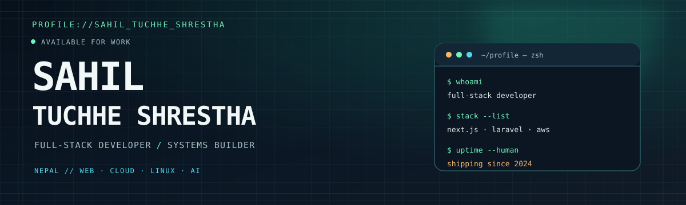
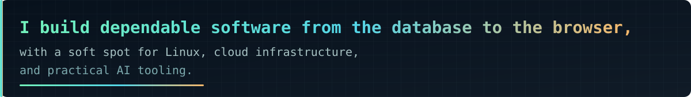
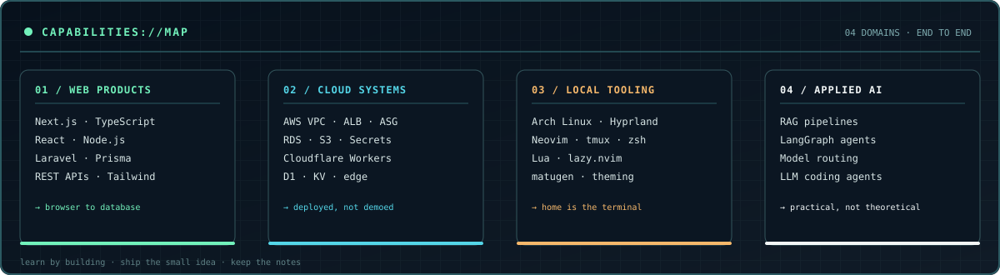

<div align="center">
  <a href="https://sahiltuchheshrestha.com.np">
    <picture>
      <source media="(max-width: 600px)" srcset="./profile-hero-mobile.svg" />
      
    </picture>
  </a>



`📍 Kathmandu, Nepal` &nbsp;·&nbsp; `🎓 BIT @ Mid Valley International College` &nbsp;·&nbsp; `🟢 open to internships`

[](https://sahiltuchheshrestha.com.np)
[](mailto:sahiltuchhe123@gmail.com)
[](https://github.com/sahilstha0007)

<br>


<br>

<a href="#what-i-do">⚡ What I do</a> &nbsp;·&nbsp; <a href="#work">🛠 Work</a> &nbsp;·&nbsp; <a href="#github-at-a-glance">📊 Stats</a> &nbsp;·&nbsp; <a href="#activity">📝 Activity</a> &nbsp;·&nbsp; <a href="#contact">📫 Contact</a>

</div>

---

<a id="what-i-do"></a>
## ⚡ What I do





> [!NOTE]
> I am a BIT student who learns by building: small experiments become real apps, and every project leaves behind notes I can actually reuse.

### 🎯 Now

```console
$ cat ~/now.md
→ finishing BIT at Mid Valley International College
→ looking for a backend / AI-ML web-dev internship
→ working through the 16-level AI Engineering Roadmap
→ shipping the portfolio and refining the terminal stack
```

---

<a id="work"></a>
## 🛠️ Selected work

| | Project | What it is | Built with |
|---|---|---|---|
| `01` | **[Portfolio](https://sahiltuchheshrestha.com.np)** | My personal site and home for experiments — editorial, motion-aware, responsive | Next.js · TypeScript |
| `02` | **[Lumin](https://github.com/sahilstha0007/lumin)** | Shop app deployed on infrastructure I built myself: VPC → ALB → ASG → RDS | Laravel · Next.js · AWS |
| `03` | **BIT212 Cloud Computing** | The AWS stack under Lumin — 2 AZs, bastion host, private RDS, auto scaling, Secrets Manager; all targets healthy, scaling verified | AWS · Apache · MySQL |
| `04` | **Postflow** | Creator command deck: pipeline kanban, calendar, hook vault, CRM, analytics, media library — on Cloudflare's edge | Next.js 16 · React 19 · D1 · KV |
| `05` | **[mydotfiles](https://github.com/sahilstha0007/mydotfiles)** | My hand-tuned Neovim setup — LazyVim, LSP, DAP, custom themes | Lua · Neovim |
| `06` | **[Agentic Career Advisor](https://github.com/sahilstha0007/aggentic-carrer-advisor)** | RAG career coach with tool-using agent workflows | Python · LangGraph · Gemini |

<a href="https://github.com/sahilstha0007/lumin">
  
</a>

---

## 🧰 Stack

<p align="center">
  <a href="https://skillicons.dev">
    
  </a>
</p>

---

<a id="github-at-a-glance"></a>
## 📊 GitHub at a glance



<div align="center">
  
  
</div>

---

## 🔥 Contribution density

<div align="center">
  <picture>
    <source media="(prefers-color-scheme: dark)" srcset="https://raw.githubusercontent.com/sahilstha0007/sahilstha0007/output/github-snake-dark.svg" />
    <source media="(prefers-color-scheme: light)" srcset="https://raw.githubusercontent.com/sahilstha0007/sahilstha0007/output/github-snake.svg" />
    
  </picture>
</div>

---

## 💬 Guestbook

> [!TIP]
> `LOG //` Leave a first-line message on [issue #1](https://github.com/sahilstha0007/sahilstha0007/issues/1). The profile workflow renders the latest signatures here.

<!-- GUESTBOOK:START -->
_No signatures yet — [be the first!](https://github.com/sahilstha0007/sahilstha0007/issues/1)_
<!-- GUESTBOOK:END -->

---

## 📡 Daily transmission

<!-- QUOTE:START -->
> [!NOTE]
> Make it work, make it right, make it fast.
> — *Kent Beck*
<!-- QUOTE:END -->

<details>
<summary><b>Open the terminal</b></summary>

```console
$ neofetch
OS        : Arch Linux x86_64
WM        : Hyprland (matugen-themed)
Terminal  : kitty
Editor    : Neovim
Shell     : zsh + atuin + mise + fzf
Uptime    : longer than my sleep schedule

$ sudo systemctl status motivation
active (running) — since 2024

$ pacman -S new-idea --noconfirm
resolving dependencies... done.
```

</details>

---

<a id="activity"></a>
## 📝 Recent activity

`● LIVE` — refreshed automatically by the profile workflow.

<!-- RECENT_ACTIVITY:START -->
- **[sahilstha0007/Framecraft](https://github.com/sahilstha0007/Framecraft)** — [fix\(ui\): play language shader across full locale reload](https://github.com/sahilstha0007/Framecraft/commit/3c6ef00dbcd5e6257447e1803393c7454f6bf342)
- **[sahilstha0007/Framecraft](https://github.com/sahilstha0007/Framecraft)** — [fix\(build\): use next/navigation pathname in shader transition](https://github.com/sahilstha0007/Framecraft/commit/fce782a7698fe8082b210e08a2e27400454753bf)
- **[sahilstha0007/Framecraft](https://github.com/sahilstha0007/Framecraft)** — [docs\(checkout\): add portfolio demo and sandbox payment notice](https://github.com/sahilstha0007/Framecraft/commit/67fc13bb3f6e1040c4d56d6b33e657c8f94ea0c2)
- **[sahilstha0007/Framecraft](https://github.com/sahilstha0007/Framecraft)** — [fix\(ui\): keep locale switch in place with fixed controls and async text swap](https://github.com/sahilstha0007/Framecraft/commit/23e0d71fb54ed339331a6493f867d7fa93828132)
- **[sahilstha0007/Framecraft](https://github.com/sahilstha0007/Framecraft)** — [feat\(ui\): dim and blur page behind mobile menu](https://github.com/sahilstha0007/Framecraft/commit/6a98459e5b558923958908d467ba63a0e8f39b2a)
<!-- RECENT_ACTIVITY:END -->

---

<a id="contact"></a>
## 📫 Let's build something

> [!TIP]
> I am open to **backend / AI-ML web-dev internships** and to interesting collaborations. If you want to talk about Next.js, AWS, developer tooling, or how I build, my inbox is open.

<div align="center">

[](mailto:sahiltuchhe123@gmail.com)
[](https://sahiltuchheshrestha.com.np)
[](https://github.com/sahilstha0007)

<br>

<i>Built with curiosity, coffee, and too many terminals.</i>

</div>
