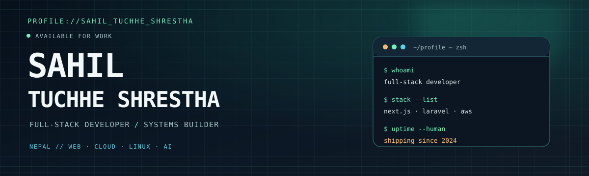
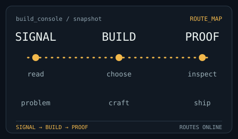

<div align="center">

<a href="https://sahiltuchheshrestha.com.np">
  <picture>
    <source media="(max-width: 600px)" srcset="./profile-hero-mobile.svg" />
    
  </picture>
</a>

I build dependable web products from the database to the browser, with a soft spot for Linux, cloud infrastructure, and practical AI tooling.

`contact:` [sahiltuchhe123@gmail.com](mailto:sahiltuchhe123@gmail.com) &nbsp;·&nbsp; `portfolio:` [sahiltuchheshrestha.com.np](https://sahiltuchheshrestha.com.np) &nbsp;·&nbsp; `status:` open to internships

</div>

<br>
## `[01]` Signal

> `interface → API → infrastructure → feedback`

- **WEB PRODUCTS** &nbsp; `Next.js · TypeScript · Laravel · Node.js`
- **CLOUD SYSTEMS** &nbsp; `AWS · VPC · ALB · RDS`
- **LOCAL TOOLING** &nbsp; `Arch · Hyprland · Neovim`
- **APPLIED AI** &nbsp; `LLM pipelines · model routing`

<br>
## `[02]` Selected work

- `SW-01` · **[Portfolio](https://sahiltuchheshrestha.com.np)** — Personal site and a home for my experiments. (`Next.js · TypeScript`)
- `SW-02` · **[Lumin](https://github.com/sahilstha0007/lumin)** — Shop application deployed on my own AWS stack. (`Laravel · Next.js`)
- `SW-03` · **[Finest](https://github.com/sahilstha0007/Finest)** — Digital marketplace for artists. (`JavaScript`)
- `SW-04` · **[mydotfiles](https://github.com/sahilstha0007/mydotfiles)** — LazyVim-based editor setup with LSP, DAP, and custom themes. (`Lua`)
- `SW-05` · **[Agentic Career Advisor](https://github.com/sahilstha0007/aggentic-carrer-advisor)** — RAG career coach with tool-using agent workflows. (`Python · LangGraph · Gemini`)

<br>
### Build console

<a href="https://github.com/sahilstha0007/lumin">
  
</a>

<br>
## `[03]` ~/whoami
```console
$ whoami
id       sahil
roles    full-stack-developer · aws-deployer · llm-tinkerer
local    arch · hyprland · neovim
mission  build useful software, understand the stack,
         and make the terminal feel like home.
```
<p align="center">
  <a href="https://skillicons.dev" aria-label="View the technologies I use">
    
  </a>
</p>

<br>
## `[04]` Guestbook
`LOG //` Leave a first-line message on [issue #1](https://github.com/sahilstha0007/sahilstha0007/issues/1). The profile workflow renders the latest signatures here.

<!-- GUESTBOOK:START -->
_No signatures yet — [be the first!](https://github.com/sahilstha0007/sahilstha0007/issues/1)_
<!-- GUESTBOOK:END -->

<br>

## `[05]` Daily transmission
<!-- QUOTE:START -->
> [!NOTE]
> Talk is cheap. Show me the code.
> — *Linus Torvalds*
<!-- QUOTE:END -->

<details>
<summary><b>Open the terminal</b></summary>

```console
$ neofetch
OS        : Arch Linux x86_64
WM        : Hyprland (matugen-themed)
Terminal  : kitty
Editor    : Neovim
Shell     : zsh + atuin + mise + fzf
Uptime    : longer than my sleep schedule

$ sudo systemctl status motivation
active (running) — since 2024

$ pacman -S new-idea --noconfirm
resolving dependencies... done.
```

</details>

<br>

## `[06]` Local setup notes

- CPU power limits are tuned with `ryzenadj`.
- `matugen` recolors applications when the wallpaper changes.
- `atuin` and `fzf` handle history and fuzzy finding.
- `satty` handles screenshot annotation.
- Dotfiles are backed up from a private repository.


<br>

## `./activity`

`● LIVE` **Recent commits + GitHub activity**

<!-- RECENT_ACTIVITY:START -->
- **[sahilstha0007/mydotfiles](https://github.com/sahilstha0007/mydotfiles)** — [feat\(stack\): achieve 10/10 stack — standalone 56ms zshrc, track CLI binaries, and zero wezterm warnings](https://github.com/sahilstha0007/mydotfiles/commit/f418a49cbe2fa1168e5e847d873ecf33d2147c74)
- **[sahilstha0007/mydotfiles](https://github.com/sahilstha0007/mydotfiles)** — [chore\(stack\): polish 10/10 terminal stack — clean lsp handlers, treesitter parsers, and pager wrapping](https://github.com/sahilstha0007/mydotfiles/commit/5aea119866875e556b2bca14235a498516ddcca6)
- **[sahilstha0007/mydotfiles](https://github.com/sahilstha0007/mydotfiles)** — [feat\(nvim\): map arrow keys to visual line navigation on wrapped text](https://github.com/sahilstha0007/mydotfiles/commit/bf22511ee74055bf074f2da2650027ba75b9b125)
- **[sahilstha0007/mydotfiles](https://github.com/sahilstha0007/mydotfiles)** — [feat\(nvim\): enable word wrap by default with visual line navigation](https://github.com/sahilstha0007/mydotfiles/commit/9f539c0f20a6c3059e2319cf1087eea64faecd61)
- **[sahilstha0007/mydotfiles](https://github.com/sahilstha0007/mydotfiles)** — [fix\(stack\): enforce one-owner-per-signal in tab\_bar, add xterm-kitty terminal-features, and clean treesitter list](https://github.com/sahilstha0007/mydotfiles/commit/625a85234adfc1ebeee0bd2b9f0c69a3a685e604)
<!-- RECENT_ACTIVITY:END -->
### Contribution density

<div align="center">

<picture>
  <source media="(prefers-color-scheme: dark)" srcset="https://raw.githubusercontent.com/sahilstha0007/sahilstha0007/output/github-snake-dark.svg" />
  <source media="(prefers-color-scheme: light)" srcset="https://raw.githubusercontent.com/sahilstha0007/sahilstha0007/output/github-snake.svg" />
  
</picture>

</div>

<br>

<p align="center"><i>Built with curiosity, coffee, and too many terminals.</i></p>
