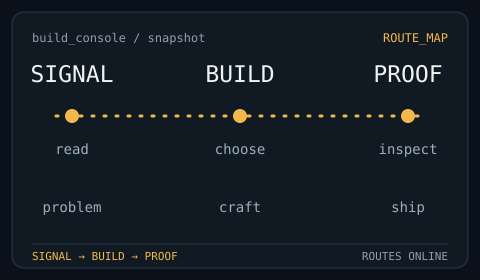
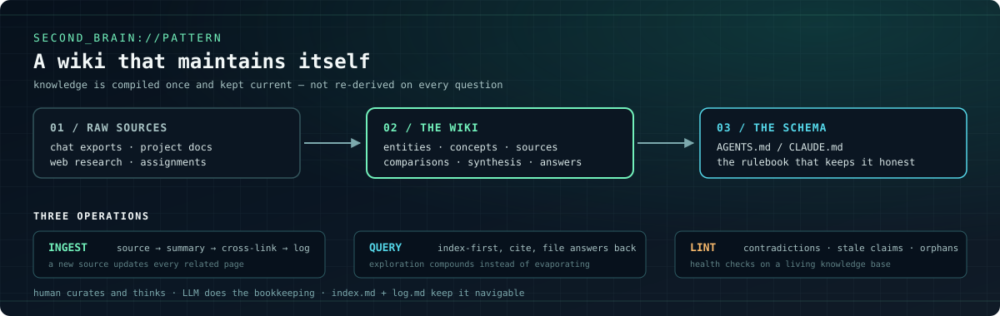

<div align="center">
  <a href="https://sahiltuchheshrestha.com.np">
    <picture>
      <source media="(max-width: 600px)" srcset="./profile-hero-mobile.svg" />
      
    </picture>
  </a>

**I build dependable software from the database to the browser — then document what I learned in a wiki that maintains itself.**

`📍 Kathmandu, Nepal` &nbsp;·&nbsp; `🎓 BIT @ Mid Valley International College` &nbsp;·&nbsp; `🟢 open to internships`

[](https://sahiltuchheshrestha.com.np)
[](mailto:sahiltuchhe123@gmail.com)
[](https://github.com/sahilstha0007)

</div>

---

## ⚡ What I do

> `interface → API → infrastructure → feedback`

- **Web products** — Next.js · TypeScript · React · Laravel · Node.js · Prisma
- **Cloud systems** — AWS (VPC · ALB · ASG · RDS), Cloudflare Workers · D1 · KV
- **Local tooling** — Arch Linux · Hyprland · Neovim · tmux · zsh · Lua
- **Applied AI** — RAG pipelines · LangGraph · model routing · LLM coding agents

I am a BIT student who learns by building: small experiments become real apps, and every project leaves behind notes I can actually reuse.

---

## 🛠️ Selected work

| | Project | What it is | Built with |
|---|---|---|---|
| `01` | **[Portfolio](https://sahiltuchheshrestha.com.np)** | My personal site and home for experiments — editorial, motion-aware, responsive | Next.js · TypeScript |
| `02` | **[Lumin](https://github.com/sahilstha0007/lumin)** | Shop app deployed on infrastructure I built myself: VPC → ALB → ASG → RDS | Laravel · Next.js · AWS |
| `03` | **[BIT212 Cloud Computing](https://github.com/sahilstha0007/lumin)** | The AWS stack under Lumin — 2 AZs, bastion host, private RDS, auto scaling, Secrets Manager | AWS · Apache · MySQL |
| `04` | **Postflow** | Creator command deck: pipeline kanban, calendar, hook vault, CRM, analytics, media library — on Cloudflare's edge | Next.js 16 · React 19 · D1 · KV |
| `05` | **[mydotfiles](https://github.com/sahilstha0007/mydotfiles)** | My hand-tuned Neovim setup — LazyVim, LSP, DAP, custom themes | Lua · Neovim |
| `06` | **[Agentic Career Advisor](https://github.com/sahilstha0007/aggentic-carrer-advisor)** | RAG career coach with tool-using agent workflows | Python · LangGraph · Gemini |

<a href="https://github.com/sahilstha0007/lumin">
  
</a>

---

## 🧠 The second brain

I keep an **Obsidian vault** whose `11 - Sahil's Wiki` folder is a living knowledge base built on the **LLM Wiki Pattern**: instead of re-reading raw documents for every question, an LLM incrementally builds and maintains a persistent, interlinked wiki.

<a href="https://github.com/sahilstha0007/sahilstha0007">
  
</a>

Right now it holds **108 pages** — 16 entities, 46 concepts, 26 source notes, comparisons, synthesis and filed answers — with **126 logged maintenance entries**. The human thinks and curates; the LLM handles the bookkeeping, so cross-references and contradictions stay current instead of rotting.

> [!NOTE]
> This is the part of my workflow I am most excited about: documentation that compounds instead of decaying.

---

## 🧰 Stack

<p align="center">
  <a href="https://skillicons.dev">
    
  </a>
</p>

---

## 📊 GitHub at a glance

<div align="center">
  
  
</div>

---

## 🔥 Contribution density

<div align="center">
  <picture>
    <source media="(prefers-color-scheme: dark)" srcset="https://raw.githubusercontent.com/sahilstha0007/sahilstha0007/output/github-snake-dark.svg" />
    <source media="(prefers-color-scheme: light)" srcset="https://raw.githubusercontent.com/sahilstha0007/sahilstha0007/output/github-snake.svg" />
    
  </picture>
</div>

---

## 💬 Guestbook

`LOG //` Leave a first-line message on [issue #1](https://github.com/sahilstha0007/sahilstha0007/issues/1). The profile workflow renders the latest signatures here.

<!-- GUESTBOOK:START -->
_No signatures yet — [be the first!](https://github.com/sahilstha0007/sahilstha0007/issues/1)_
<!-- GUESTBOOK:END -->

---

## 📡 Daily transmission

<!-- QUOTE:START -->
> [!NOTE]
> Weeks of coding can save you hours of planning.
> — *Unknown*
<!-- QUOTE:END -->

<details>
<summary><b>Open the terminal</b></summary>

```console
$ neofetch
OS        : Arch Linux x86_64
WM        : Hyprland (matugen-themed)
Terminal  : kitty
Editor    : Neovim
Shell     : zsh + atuin + mise + fzf
Uptime    : longer than my sleep schedule

$ sudo systemctl status motivation
active (running) — since 2024

$ pacman -S new-idea --noconfirm
resolving dependencies... done.
```

</details>

---

## 📝 Recent activity

`● LIVE` — refreshed automatically by the profile workflow.

<!-- RECENT_ACTIVITY:START -->
- **[sahilstha0007/Framecraft](https://github.com/sahilstha0007/Framecraft)** — [fix\(ui\): reserve nav link widths so locale switch doesn't shift layout](https://github.com/sahilstha0007/Framecraft/commit/c3d9bb7bb6216afacc59862e183f3d5c9c02e0d6)
- **[sahilstha0007/Framecraft](https://github.com/sahilstha0007/Framecraft)** — [fix\(ui\): add scroll hysteresis to stop navbar jitter](https://github.com/sahilstha0007/Framecraft/commit/80a4f728e85450ece56aa105d6d1a66bc721e89d)
- **[sahilstha0007/Framecraft](https://github.com/sahilstha0007/Framecraft)** — [fix\(deploy\): scope standalone output to container builds for Vercel](https://github.com/sahilstha0007/Framecraft/commit/1cba397fb48708c7adc2a830cffee721bcff2b0d)
- **[sahilstha0007/mydotfiles](https://github.com/sahilstha0007/mydotfiles)** — [Rating the ui and feature asthestics](https://github.com/sahilstha0007/mydotfiles/commit/171cd474826d2b19fa62dba63112d9363b59adb6)
- **[sahilstha0007/mydotfiles](https://github.com/sahilstha0007/mydotfiles)** — [feat\(bin\): prioritize bun as primary package manager in project-task](https://github.com/sahilstha0007/mydotfiles/commit/8d365a7cdcfa4f0c2141109ff16eef7e800fefee)
<!-- RECENT_ACTIVITY:END -->

---

<div align="center">
  <i>Built with curiosity, coffee, and too many terminals.</i>
</div>
